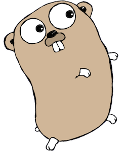

<p align="center">
  
</p>

<h1 align="center">Learn Go from PHP</h1>

Hands-on, annotated Go tutorials for PHP and Laravel developers. Each lesson is a small, runnable program that explains Go concepts side by side with their PHP equivalents, starting from the basics and building towards practical tools you can use alongside your PHP apps.

## Requirements

- [Go](https://go.dev/dl/) 1.25 or newer (some lessons use `sync.WaitGroup.Go` and `testing.B.Loop`)

Check your version with:

```bash
go version
```

## Getting started

```bash
git clone https://github.com/phoenix1331/learn-go-from-php.git
cd learn-go-from-php
go run ./01-basics
```

All commands are run from the repo root.

## Lessons

Work through them in order. Each one builds on the last. Progress, planned future lessons and session notes are tracked in [LEARNING_LOG.md](LEARNING_LOG.md).

| # | Lesson | Topics | Run |
|---|---|---|---|
| 01 | [Basics](01-basics/main.go) | Packages, variables, `:=`, types, zero values, strings, `Printf`, constants, `iota` | `go run ./01-basics` |
| 02 | [Control flow](02-control-flow/main.go) | `if` with init statements, `for` (the only loop), `range`, `switch`, `defer` | `go run ./02-control-flow` |
| 03 | [Functions](03-functions/main.go) | Multiple returns, `(result, error)`, named returns, variadics, closures, pointers | `go run ./03-functions` |
| 04 | [Collections](04-collections/main.go) | Arrays, slices, maps, "comma ok", sorting, `slices` and `maps` packages | `go run ./04-collections` |
| 05 | [Structs & methods](05-structs-methods/main.go) | Structs vs classes, constructors, value vs pointer receivers, embedding, struct tags | `go run ./05-structs-methods` |
| 06 | [Interfaces](06-interfaces/main.go) | Implicit interfaces, `fmt.Stringer`, dependency swapping, type assertions, type switches, `any` | `go run ./06-interfaces` |
| 07 | [Errors](07-errors/main.go) | Errors as values, sentinel errors, wrapping with `%w`, `errors.Is` / `errors.As`, custom errors, panic/recover | `go run ./07-errors` |
| 08 | [Concurrency](08-concurrency/main.go) | Goroutines, `WaitGroup`, channels, worker pools, `select` with timeouts, mutexes | `go run ./08-concurrency` |
| 09 | [Generics](09-generics/main.go) | Type parameters, constraints, generic `Map` / `Filter` / `Sum`, generic types | `go run ./09-generics` |
| 10 | [JSON CLI tool](10-json-cli/main.go) | Flags, JSON encode/decode, stdin/stdout/stderr, exit codes | `go run ./10-json-cli --name=You --pretty` |
| 11 | [HTTP server](11-http-server/main.go) | Standard-library JSON API, routing with methods and `{params}`, middleware | `go run ./11-http-server` |
| 12 | [Testing](12-testing/mathutil_test.go) | `go test`, table-driven tests, subtests, benchmarks, coverage | `go test -v ./12-testing` |

### Lesson 10 examples

```bash
go run ./10-json-cli --name=Darren --count=3 --pretty
echo '{"items":["b","a","c"]}' | go run ./10-json-cli --stdin
go run ./10-json-cli --count=-1; echo "exit code: $?"
go run ./10-json-cli --help
```

### Lesson 11 examples

Start the server, then in a second terminal:

```bash
curl localhost:8080/health
curl -X POST localhost:8080/tasks -d '{"title":"Learn Go"}'
curl localhost:8080/tasks
curl localhost:8080/tasks/1
```

Stop the server with `Ctrl+C`.

### Lesson 12 examples

```bash
go test ./12-testing           # run tests
go test -v ./12-testing        # verbose output
go test -cover ./12-testing    # code coverage
go test -bench=. ./12-testing  # benchmarks
go test ./...                  # every package in the repo
```

## Things to try

- **Lesson 04:** run it several times and watch the map iteration order change.
- **Lesson 08:** remove the `mu.Lock()` / `mu.Unlock()` lines, then run `go run -race ./08-concurrency` to see Go's race detector catch the bug.
- **Any lesson:** add an unused variable or import and see the compiler refuse to build it.
- **Lesson 12:** break `IsPalindrome` on purpose and see how the table-driven test reports which case failed.

## Using Go alongside PHP

Lessons 10 and 11 show the two most common ways to use Go for heavy lifting in a PHP / Laravel app.

**As a CLI binary** (lesson 10):

```bash
go build -o bin/jsoncli ./10-json-cli
```

```php
use Illuminate\Support\Facades\Process;

$result = Process::run([base_path('bin/jsoncli'), '--name=Darren']);

if ($result->successful()) {
    $data = json_decode($result->output(), true);
}
```

**As an HTTP service** (lesson 11):

```php
use Illuminate\Support\Facades\Http;

$task = Http::post('http://localhost:8080/tasks', ['title' => 'Learn Go'])->json();
```

To build for a different server OS or CPU:

```bash
GOOS=linux GOARCH=amd64 CGO_ENABLED=0 go build -o bin/jsoncli ./10-json-cli
```

## Useful commands

| Command | What it does |
|---|---|
| `go run ./folder` | Compile and run a program |
| `go build -o name ./folder` | Compile to an executable |
| `go test ./...` | Run all tests |
| `go vet ./...` | Report likely mistakes |
| `gofmt -w .` | Format all code (or use `go fmt ./...`) |
| `go doc fmt.Println` | Show documentation in the terminal |

## Further reading

- [A Tour of Go](https://go.dev/tour/): interactive official tutorial
- [Go by Example](https://gobyexample.com/): short annotated examples
- [Effective Go](https://go.dev/doc/effective_go): idiomatic style
- [Standard library docs](https://pkg.go.dev/std)

## Credits

The Go gopher was designed by [Renée French](https://reneefrench.blogspot.com/) and is licensed under [Creative Commons Attribution 4.0](https://creativecommons.org/licenses/by/4.0/). The image is from the [Go blog](https://go.dev/blog/gopher).
